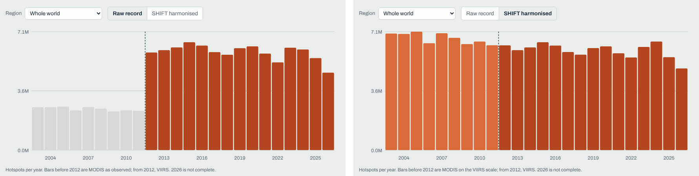
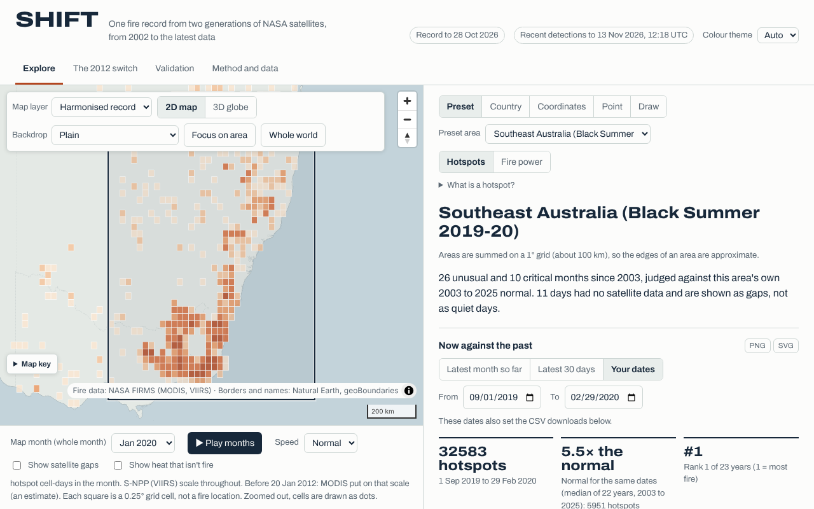

# SHIFT: one fire record from two generations of NASA satellites

**SHIFT** (Satellite Harmonization & Integrated Fire Tracking) by Team Squadron Zero, for the NASA Space Apps Challenge 2026, theme *The Next Frontier*, Challenge 9: **Harmonization of MODIS and VIIRS Hot Spots**.

**Website: https://squadronzero.github.io/project-shift/** (backup copy with the same files: https://project-shift.pages.dev/)

SHIFT turns NASA FIRMS active-fire detections from MODIS (Terra and Aqua, 1 km pixels, from 2002) and VIIRS (Suomi NPP from 2012, NOAA-20 from 2018, 375 m pixels) into one consistent, uncertainty-aware burning-activity calendar for any area on Earth, from 2003 to 28 October 2026, with the newest raw detections shown beside it.



*Hotspots per year, whole world. Left: the raw joined record. Right: SHIFT, with the MODIS years put on the VIIRS scale. From the website's "The 2012 switch" page.*

Why now: NASA FIRMS stopped producing Suomi NPP data at 13:00 UTC on 2 November 2026 ([NASA FIRMS FAQ](https://www.earthdata.nasa.gov/data/tools/firms/faq)), and the Terra and Aqua MODIS missions are near their end. A fire record that runs from the 2000s to today only stays usable if the sensors are tied together.

## For reviewers: the two-minute version

**The problem.** VIIRS sees small and cool fires that MODIS misses. Joined end to end, the global record jumps 2.64 times in 2012. That is the satellite changing, not the planet.

**The method, in five steps** (full mathematics: [`docs/audit/HARMONIZATION_EQUATIONS.md`](docs/audit/HARMONIZATION_EQUATIONS.md)):

1. Every FIRMS detection that passes the filters (nominal and high confidence, vegetation fires, outside a mask of 77,706 persistent non-fire heat cells) becomes a **hotspot**: a 0.05° grid cell with fire on a day, with its fire radiative power (FRP) summed. Counting cells instead of pixels removes most of the 1 km against 375 m pixel effect.
2. For each 2.5° cell and calendar month, SHIFT measures a factor **k = VIIRS total / MODIS total** over the years both satellites flew, pulled towards its 10° tile where fire is sparse. The same is done for hotspots and for fire power.
3. Every MODIS month before 2012 is multiplied by its k, which puts it on the Suomi NPP scale. From 2012 the record is Suomi NPP itself. NOAA-20 fills Suomi NPP outages and carries the record on (NOAA-20 to Suomi NPP: 1.00 to 1.02 for hotspots and 0.96 to 0.99 for fire power, every year from 2018 to 2026).
4. Satellite outages are filled from a partner satellite or shown as "no data", never as zero fire.
5. Every choice that could tilt a result (which MODIS satellites, which formula, which grid size, how to fill gaps) was decided by a rule written into `config/settings.yaml` and committed to git before the run that judged it.

**There is no intercept.** The factor is a ratio of totals, so a place and month with no MODIS fire stays at zero. The team's first prototype (v1, Florida only) used a straight line with an intercept, VIIRS_FRP = 0.316 x MODIS_FRP + 24.7. SHIFT replaced it (decision D21) because the intercept adds fire power that was never observed: the v1 line had a global backward-test error of -29.3% against +0.5% for the ratio. The v1 line is kept only as the Florida regression check.

**Headline results** (all on the website's Validation page, each with what it cannot show):

| Result | Value | What it does not show |
| --- | --- | --- |
| The 2012 jump, whole world (2013-2015 against 2009-2011) | raw 2.64×, SHIFT 0.97×, MODIS alone 0.96× | The factors were fitted on 2012-2019, so this shows continuity at the switch, not that the factors are right before 2012 |
| Gap between SHIFT and MODIS alone at the switch | +0.8% hotspots, -0.2% fire power (gate ±5%, PASS) | Three test regions stay near 10% (Iberia +11.8%, Siberia -8.7%, Florida -7.0%) |
| Backward test: factors fitted on 2016-2019 predict 2012-2015 | fire-weighted median error of each 2.5° cell's four-year total about 4% | Single months are about 18% (hotspots) to 22% (fire power) |
| Against simpler methods | SHIFT 69.3 against 57.6 for the best simple method (v1 line 42.9) | SHIFT's settings were chosen on tests of this kind, so its lead may be a little optimistic |
| Untouched 2026 test (locked away until the model was final) | NOAA-20 PASS (+0.1% hotspots, +1.0% fire power) | Tests the satellite links used from 2020, not the MODIS factors used before 2012 |

**What SHIFT cannot claim.** There is no VIIRS before 2012, so the factor for those years assumes each place's VIIRS to MODIS ratio stayed the same. That cannot be measured. The only outside check, GFED4 burned area, is itself built from MODIS. The 95% ranges cover conversion error only. Day and week values before 2012 are indicative. The full list is in [`docs/audit/SCIENTIFIC_LIMITATIONS.md`](docs/audit/SCIENTIFIC_LIMITATIONS.md).

**Where to look:**

| You want | Go to |
| --- | --- |
| See it working | The [website](https://squadronzero.github.io/project-shift/): "The 2012 switch", then Explore (any area by preset, country, coordinates, point or drawn box) |
| Every test and its limits | The website's Validation page, then [`docs/audit/VALIDATION_REPORT.md`](docs/audit/VALIDATION_REPORT.md) |
| The method and an independent-minded review of it | [`docs/audit/SCIENTIFIC_METHODOLOGY.md`](docs/audit/SCIENTIFIC_METHODOLOGY.md) |
| Rerun the checks on the published data | [`validation/`](validation/) |
| Rerun the whole pipeline | [`docs/COLAB_GUIDE.md`](docs/COLAB_GUIDE.md) and [`docs/RUNBOOK.md`](docs/RUNBOOK.md) |
| How AI was used | [`docs/AI_USE.md`](docs/AI_USE.md) |



*Explore: any area against its own 2003 to 2025 normal. Here Southeast Australia during the 2019-20 Black Summer.*

## Repository layout

```
config/settings.yaml        every tunable value and every decision rule, committed before the run it judges
docs/
  SCIENTIFIC_SPECIFICATION.md  the scientific questions and scope (written 3 Oct 2026, before the method)
  DATA_CONTRACT.md             exact format of every dataset (L1, L2, L3)
  COLAB_GUIDE.md               how to run the pipeline on Google Colab
  RUNBOOK.md                   stage order, inputs, outputs and run times
  AI_USE.md                    every AI tool used, what it did, what the team did
  audit/                       method, equations, validation report, limitations, reproducibility, judging notes
  preflight/                   checks for the recent detections layer and the scientific baseline fingerprints
pipeline/
  shift/adapters/firms_csv.py  converts FIRMS CSV files to Level 1
  shift/ingest.py              stage 1: clean, filter, de-duplicate -> L1 detections
  shift/aggregate.py           stage 2: grid to 0.05 deg cell-days -> L2
  shift/fetch.py               downloads FIRMS yearly world files straight to cell-days
  shift/scan.py                re-reads yearly files: versions, non-fire sources, fingerprints
  shift/qc.py                  data health check (coverage, gaps, ratios)
  shift/crosscheck.py          global yearly files vs Florida form download
  shift/counts.py              detection-count harmonisation (the 2012 jump)
  shift/selection.py           six tests choose the MODIS calibration source (D19)
  shift/frp.py                 fire power without the v1 intercept (D21)
  shift/tiles.py               worldwide check of D19 and D21 on a grid covering the whole Earth
  shift/factors.py             D21 factors for every place on Earth
  shift/confidence.py          low-confidence cell-days and the confidence asymmetry test
  shift/nodata.py              no-data mask: regional gaps, gap filling tested on simulated outages
  shift/places.py              per-place choices, borrowed factors tested, confidence drift
  shift/resolution.py          10-degree vs 2.5-degree factors judged at fine scale (D28)
  shift/daily.py               skill of the MODIS years by day, week and month, UTC vs local solar day
  shift/external.py            GFED4 burned area and MERRA-2 cloud, downloaded and reduced
  shift/harmonise.py           the harmonised record L3 (0.25 deg, daily, Suomi NPP scale) with sources and uncertainty
  shift/checks.py              final checks: anomaly rule, untouched 2026 test, range coverage, simple methods, known events, burned area, cloud
  shift/export.py              static website files and site_data.zip
  shift/solar.py               local solar day of a satellite pass
  shift/provenance.py          git commit, settings hash and software versions stamped into every report
  shift/run.py                 one command runs every stage
  shift/quickstart.py          2-minute demo on samples/florida_sample.zip (v1 baseline, see below)
  tests/                       automated checks
web/                           the website (React + MapLibre, static files only)
recent/                        near-real-time FIRMS fetch for the recent detections layer
context/                       NASA POWER weather context for preset areas
geo/                           map geography (Natural Earth, geoBoundaries) and its licence filter
validation/                    reruns the independent checks on the published site data
samples/                       small real FIRMS sample for the quickstart
data/                          not in git: raw files live on the team's Google Drive
```

## Try it in 2 minutes (no download, no account)

```bash
git clone https://github.com/squadronzero/project-shift.git && cd project-shift/pipeline
pip install -r requirements.txt
python -m shift.quickstart
```

This runs the data path on `samples/florida_sample.zip`, about 57,000 real NASA FIRMS detections over Florida for 2020 and 2023: clean and filter, grid to 0.05° cell-days, fit a MODIS to VIIRS line on 2020, and test it on 2023 at four scales. It finishes in seconds.

> **Note for reviewers.** The quickstart reproduces the team's **v1 Florida baseline**, an ordinary least squares line fitted on one year, so it prints a line with an intercept (for example `VIIRS_FRP = 0.4867 x MODIS_FRP + 14.75`) and low single-day scores. That line is the regression check every new result had to match first. **It is not SHIFT's method.** SHIFT uses a ratio of totals per 2.5° cell and calendar month, with no intercept (D21, see "For reviewers" above). The quickstart's last line points to the scientific questions. The method is in [`docs/audit/HARMONIZATION_EQUATIONS.md`](docs/audit/HARMONIZATION_EQUATIONS.md). The full harmonisation needs the global FIRMS archive (about 422 million detections read) and runs on Google Colab ([`docs/COLAB_GUIDE.md`](docs/COLAB_GUIDE.md)). Its outputs ship with the website and can be checked with [`validation/`](validation/).

## Quick start (full pipeline)

```bash
cd pipeline
pip install -r requirements.txt
python -m pytest -q        # all tests pass
python -m shift.run --dataset florida   # reads data/raw/florida/, writes data/processed/florida/
```

On Colab, follow `docs/COLAB_GUIDE.md`.

## Pipeline stages

| Stage | Input | Output | Status |
| --- | --- | --- | --- |
| fetch | FIRMS yearly world zips: MODIS 2002+, VIIRS S-NPP 2012+, VIIRS NOAA-20 2018+ | L2 cell-days (global, no raw kept) | Done |
| scan | FIRMS yearly world zips (re-read) | version labels, non-fire source cells + static-source mask, file fingerprints | Done |
| qc | L2 | daily coverage, data gaps, yearly ratios, version step check | Done |
| crosscheck | L2 global + L2 florida | download-route agreement, PASS/CHECK | Done |
| ingest | FIRMS CSV (archive + NRT) | L1 detections | Done |
| aggregate | L1 | L2 cell-days, 0.05 deg | Done |
| calibrate | L2 overlap 2012-2021, satellite outage days left out | v1 OLS line + validation at 4 scales (the Florida regression check, not SHIFT's method) | Done |
| quickstart | `samples/florida_sample.zip` | the v1 baseline data path in seconds, in a temporary folder | Done |
| counts | L2 global | detection-count harmonisation: active cell-days, MODIS scaled to VIIRS per region and month, 2012 jump measured | Done |
| continuity | counts daily series | NOAA-20 tied to S-NPP per region and month (cells and fire power), tested on 2024-2025, S-NPP outage days filled | Done |
| sources | counts daily series | fix 1 fitted from MODIS merged, Aqua alone and Terra alone, holdout error, 2012 step and orbital drift compared | Done |
| selection | counts daily series + L2 | six fair tests (backward, category agreement, leave-one-year-out, MODIS-era stability, bootstrap, fire size) choose the MODIS calibration source by a rule fixed before the run | Done |
| frp | counts daily series + L2 pairs | fire power harmonisation: v1 line, line with intercept, line through zero, paired ratio and ratio of totals compared with the same tests and rule | Done |
| worldwide | L2 global | D19 and D21 re-tested on a 10° grid of tiles over the whole Earth, confirm rule fixed before the run, first factors for every place | Done |
| factors | L2 global + static mask | D21 production factors for every 10° tile (burning cells and fire power, each D19 piece on all its years, bootstrap range), non-fire mask in every year, fire-size split, zone borrowing and seasonal smoothing tested by rule fixed before the runs | Done |
| confscan | FIRMS yearly world files | Low-confidence vegetation-fire detections only, as cell-days in their own folder (`celldays_low`), main record untouched | Done |
| confidence | L2 global + `celldays_low` | Low-confidence share per satellite, year and tile, keeping low for MODIS, VIIRS or both scored against the current filter by a rule fixed before the run | Done |
| nodata | L2 global + qc coverage table | Regional gaps (a satellite far below its partner in one 30-degree zone), fill links (S-NPP <- NOAA-20, S-NPP <- D19 MODIS, MODIS <- Aqua or Terra) tested on simulated outages under a rule fixed before the run, status per zone and day (primary, filled, no data) and per zone and month with an expected error | Done |
| places | L2 global + static sources + counts + confidence outputs | Stronger non-fire mask in flare tiles, MODIS source per tile chosen on 2016-2025 and judged on 2012-2015, borrowed factors rebuilt without each tile and tested, confidence drift per tile, Bangladesh spotlight with a first harmonised calendar. Every choice under a rule fixed before the run | Done |
| resolution | L2 global + factors | 2.5-degree factors (D28), the 2018 MODIS version test, the regional 2012-step test (option E), writes `counts/fine_monthly.parquet` for later stages | Done |
| daily | L2 + resolution | skill of MODIS x k by day, week and month (out of sample), labels for pre-2012 time scales, UTC vs local solar day | Done |
| external | NASA Earthdata (GFED4, MERRA-2) | burned area and cloud per month, reduced to small tables | Done |
| harmonise | L2 + all choices above | L3 harmonised record, hybrid fills with scaling, region tables, provenance | Done |
| checks | L3 + fine monthly + outside data | final checks of the harmonisation (see `docs/RUNBOOK.md`) | Done |
| export | L3 + all reports | website files: daily values per 1° cell, monthly 0.25° map layers, baselines, month classes, uncertainty, not-a-fire layer, validation reports (`site_data.zip`) | Done |

Each stage writes `data/processed/<dataset>/report_<stage>.json` with row counts and rejection reasons, so every number in the app can be traced back.

## NASA data sources used

| Dataset | What we use it for | How |
| --- | --- | --- |
| NASA FIRMS MODIS Collection 6.1 active fires (Terra and Aqua, 1 km), https://firms.modaps.eosdis.nasa.gov/ | The long record, 2002 onwards (comparable from 2003) | Yearly world archive files 2002-2025 plus a form download for 2026, cleaned, gridded to 0.05 deg cell-days |
| NASA FIRMS VIIRS 375 m active fires (Suomi NPP), https://firms.modaps.eosdis.nasa.gov/ | The reference sensor the MODIS record is calibrated to, 2012 onwards | Same route as MODIS, paired with MODIS on the same cell and day to fit and test the calibration |
| NASA FIRMS VIIRS 375 m active fires (NOAA-20), https://firms.modaps.eosdis.nasa.gov/ | Continuity: NASA FIRMS stopped producing Suomi NPP data at 13:00 UTC on 2 Nov 2026 (NASA FIRMS FAQ). NOAA-20 carries the same instrument (2018 onwards) | Same route, tied to S-NPP over 2018-2026 (NOAA-20 to S-NPP: 1.00 to 1.02 for hotspots, 0.96 to 0.99 for fire power, every year) and fills S-NPP outages |
| NASA FIRMS VIIRS 375 m near-real-time active fires (NOAA-20 and NOAA-21), FIRMS area API | The "Recent detections" layer, from 28 Oct 2026 to the latest fetch | Fetched by the Website workflow, checked row by row, shown raw with its fetch time, never mixed into the harmonised record. NOAA-21 is labelled as not tested against S-NPP |
| NASA POWER daily meteorology (PRECTOTCORR, RH2M, T2M_MAX, WS2M, GWETROOT), https://power.larc.nasa.gov/ | "Weather at the time" beside "Now against the past" for the preset areas | Mean of the land points of a 3 x 3 grid per area, same dates in every year from 2003. Context only, never used in the record or any score (`context/`) |
| NASA MERRA-2 M2TMNXRAD v5.12.4, total cloud fraction CLDTOT, NASA GES DISC | Cloud flags on months | Monthly cloud per area, months cloudier than 90% of years carry a flag |
| NASA GIBS (Blue Marble and daily true-colour layers) | Optional satellite backdrop on the map and globe | Online only, visualisation only |

Dataset citations (as requested by NASA FIRMS):

- MODIS Collection 6 Hotspot / Active Fire Detections MCD14ML distributed from NASA FIRMS. https://doi.org/10.5067/FIRMS/MODIS/MCD14ML
- MODIS Collection 61 NRT Hotspot / Active Fire Detections MCD14DL distributed from NASA FIRMS. https://doi.org/10.5067/FIRMS/MODIS/MCD14DL.NRT.0061
- NRT VIIRS 375 m Active Fire product VNP14IMGT distributed from NASA FIRMS. https://doi.org/10.5067/FIRMS/VIIRS/VNP14IMGT_NRT.002
- NRT VIIRS 375 m Active Fire product VJ114IMGTDL_NRT distributed from NASA FIRMS. https://doi.org/10.5067/FIRMS/VIIRS/VJ114IMGT_NRT.002

We acknowledge the use of data from NASA's Fire Information for Resource Management System
(FIRMS, https://www.earthdata.nasa.gov/firms), part of NASA's Earth Science Data and Information System (ESDIS).

Outside data used only for checks:

- GFED4 monthly burned area without small fires (Giglio, Randerson and van der Werf 2013), ORNL DAAC. https://doi.org/10.3334/ORNLDAAC/1293
- MERRA-2 monthly radiation diagnostics M2TMNXRAD v5.12.4, total cloud area fraction CLDTOT (Global Modeling and Assimilation Office), NASA GES DISC. https://doi.org/10.5067/OU3HJDS973O0

Other data: Florida state outline (`config/regions/florida.geojson`), a public-domain US state boundary. Map geography from Natural Earth (public domain) and geoBoundaries gbOpen (per-country licences in `web/public/geo/index.json`, sources in `geo/README.md`).

## Tools and references

Python, pandas, NumPy, PyArrow, PyYAML, Shapely, h5py, pytest. React, MapLibre GL JS, Vite. Playwright for browser checks.
Google Colab and Google Drive, GitHub Actions and GitHub Pages. MODIS C6.1 and VIIRS 375 m active-fire user guides (NASA FIRMS).

- Giglio, L., Schroeder, W., Justice, C. O. (2016). The collection 6 MODIS active fire detection
  algorithm and fire products. Remote Sensing of Environment, 178, 31-41. https://doi.org/10.1016/j.rse.2016.02.054
- Schroeder, W., Oliva, P., Giglio, L., Csiszar, I. A. (2014). The New VIIRS 375 m active fire
  detection data product: Algorithm description and initial assessment. Remote Sensing of
  Environment, 143, 85-96. https://doi.org/10.1016/j.rse.2013.12.008
- Giglio, L., Randerson, J. T., van der Werf, G. R. (2013). Global Fire Emissions Database, Version 4 (GFEDv4). ORNL DAAC. https://doi.org/10.3334/ORNLDAAC/1293
- Runfola, D. et al. (2020). geoBoundaries: A global database of political administrative boundaries. PLoS ONE 15(4): e0231866. https://doi.org/10.1371/journal.pone.0231866
- SHIFT v1 Florida prototype (Team Squadron Zero): https://github.com/nasifnaser06-cyber/Project_S.H.I.F.T

## Scientific audit (8 Nov 2026)

A critical review of the method, the validation and the reproducibility, including what is not
supported: `docs/audit/SCIENTIFIC_METHODOLOGY.md` (start here), with the equations, validation
report, limitations, reproducibility guide, improvement plan and judging notes beside it.
`validation/audit_site_data.py` reruns the independent checks on the published site data.
The audit was written by the same AI system that wrote the code (see `docs/AI_USE.md`), at the team's
request and with the instruction to review critically. On 11 Nov 2026 it was followed by a correction
of overstated validation claims (`docs/audit/SCIENTIFIC_CLAIMS_CORRECTION_2026-11-11.md`).

## Use of AI

Claude (Anthropic) was the team's engineer and scientific collaborator: it proposed the
harmonisation method (each step approved by the team under a rule fixed before the run), designed
the validation, and wrote nearly all of the code, tests and documentation. ChatGPT (OpenAI) helped
build the earlier Florida prototype, then tutored the team and reviewed Claude's work. Gemini
(Google), as the "SHIFT Tutor" Gem, was the team's main tutor. Video 1 used AI-generated footage
from Google Veo through Google Flow. The team chose the challenge, obtained every dataset, ran
every computation, approved every decision and reviewed every change. No AI runs inside SHIFT and
every number comes from tested code. Full details: `docs/AI_USE.md`.

## Licence

Apache License 2.0 (see `LICENSE`).

## Website

`web/` holds the SHIFT website (React + MapLibre, static files only). The pipeline's `export` stage
writes `site_data.zip`, it is published as the GitHub release `site-data`, and the workflow
`Website` (`.github/workflows/pages.yml`) downloads it, builds the site and publishes it on GitHub
Pages at https://squadronzero.github.io/project-shift/ , with the same files copied to https://project-shift.pages.dev/
as a backup. Every 3 hours it also fetches the newest FIRMS detections for the recent layer. See
`web/README.md` for running it locally or offline.
